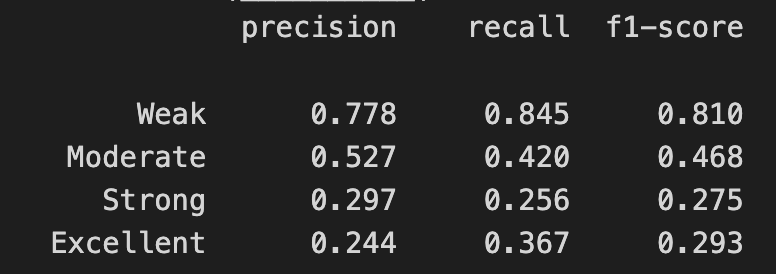

# CSEN 166 — Term Team Project for Social Impact (TTP4SI)

**Team:** A4  
**Challenge:** Ardook 
**Team members:** Shreya Vishwanath, Thien Giap Do, Timothy Le, Yash Sanghvi  
**Repository:** https://github.com/SCU-CSEN166/ArdookGrantProject 
**Last updated:** 11/18/26

> **How to use this README:** Maintain this single file throughout the project. Complete the Week 5 project plan first, then update the appropriate weekly section before each milestone. Be specific and honest: describe what you attempted, what worked, what did not work, and what evidence supports your conclusions. For every week, document each member's actual contribution. If a task was not completed, explain the blocker and next step. Do not include private or sensitive data in this public README.

## Remember - Best Practices

### Data access and privacy

Data can be accessed through the Final Copy of Ardook Grant Data file located in the repository. No restricted or personal information can be found in the data records.

### Known limitations

As we near week 10, the system is fully functional and can take an input of grant data, evaluate Ardook and Ardook Data's eligibility for each grant and output a file detailing the findings of its evaluation and the reasoning behind each evaluation. The system gives each grant a rating, from ineligible, moderate, eligible, or excellent.

## Week 5 — Scope: Project Plan

**Deliverable during Week 6 Lab:** A project plan (write in this README file) describing your problem formulation, proposed approach, each team member's responsibilities, proposed baseline models with Hugging Face links, proposed evaluation metrics, proposed data with links, and goals for each week.

### 1. Problem formulation and social impact

- **Problem:** What specific task are you solving? Ardook provides mothers, who are unable to leave their childrens' sides, with job opportunities and therefore, stable sources of income. To continue their work, Ardook requires adequate funding, much of which can be obtained through grants for social impact organizations and non-profits. However, the process of identifying relevant grant options and determining eligibility for such grants can be time-consuming and tedious for the non-profit employees. Our AI agent will streamline this process by identifying applicable grants and making suggestions to the non-profit regarding which grants are a best-fit and which should be applied to.
- **Intended users:** Who would use the system, and for what decisions or activities? The primary users of this system will be the employees of Ardook who are in charge of obtaining grant funding for the organization. They will be able to search for grants using the software and/or recieve suggestions for grants that Ardook is eligible for and could apply to. If the project expands outside of Ardook, other non-profit organizations that are also interested in expediting their grant search process could also utilize this AI system.
- **Inputs and outputs:** What will the system receive and produce? Give one concrete example. The system would receive information about a grant and would output whether Ardook is eligible for the grant.
- **Success criteria:** What would make the system useful and reliable? The system could be considered useful if it provides reliable reccomendations for grants with minimal to zero hallucinated reccomendations. It would also be considered successful if Ardook is able to apply to and receive grants from a multitude of sources because they match the criteria of what the grant is looking for.
- **Constraints and risks:** Some risks include maintaining the privacy of Ardook as the AI system gathers information about them and uses it to search for grants. Another risk is hallucinations as we test the model and try to ensure that it produces a competent responses.

### 2. Proposed technical approach

Proposed Technical Approach

Initially, as we were brainstorming how to help Ardook target grants efficiently and effectively, our first intuition was the simple one. We can compare Ardook’s vision and purpose from their website and statements to various grants out there. The idea is to retrieve grants that share similar visions and purposes. Obviously, we couldn’t do exact word matching because that would simply be impossible and tedious. So our first and initial approach is to find similarities between Ardook and grants. For this, we would need to use hugging face models that are suited and equipped to find similarities between texts and documents given to it.
Building off of the initial approach that we have, we also want to incorporate TF-IDF to retrieve grants that stand out among many grants especially to Ardook. Another consideration for this is to remove stop words that are common in the English language but have no real significance to our grant search for Ardook. 
Something we can do to help our search is to build a bag of words that are specific to Ardook and what they are trying to accomplish. As we train our models on different data, we can add or subtract to that bag of words depending on the performance.
In terms of using the dataset given to us from Ardook, we will need to clean that data and categorize it in a way that is helpful and useful for our models to interpret and train against.

Models

- **sentence-transformers/all-MiniLM-L6-v2**
This model from Hugging Face turns sentences and paragraphs into a compact vector space. Which it will do for synthetic data first and compare it to the vector space of our Ardook’s data and information.
The way this model actually helps us is that it can measure similarities between documents and texts by using cosine similarity which is actually something I just learned in my data mining class. 
A cool feature for this model as well is that it can catch similar words as we were hoping for in our solution because exact matching would not be feasible or effective at all.
This is a great starter model for us because it is lightweight and easy to iterate and test with before moving on to bigger and complex models. But it will also give us a good sense of our data and how we can improve our training dataset.
- **BAAI/bge-small-en-v1.5**
This model is also a good option for our approach to solve our problem. It is different from the MiniLM because it is designed specifically for information retrieval.
Instead of just passing all of Ardook’s information into a vector space, I would create an instruction + a query for Ardook. So it requires more details and thought behind our query to best maximize our retrieval. Then we can run it against our synthetical data then eventual real data.
- **cross-encoder/ms-marco-MiniLM-L-6-v2**
The first two proposed models are both bi-encoders which means they produce separate embeddings for Ardook and grants. With this model, we can go beyond that with the ability to combine their data simultaneously. This is helpful because our earlier bi-encoder models can miss negative combinations or correlation because it was embedded separately but this will combine the two which in turn will reveal more to us.
- **deepseek-ai/DeepSeek-R1-Distill-Qwen-1.5B**
This model requires a thinking process, which slows it down, but allows it to output reasoning behind decisions made in model evaluation. This could be useful for our results, especially more moderate or neutral examples, to pinpoint the highlights of each grant alongside the result. 
- **Qwen3-4B and Qwen3-32B**
These models offer strong reasoning skills and the ability to process heavy workloads. They can be used to parse through lengthy sections of grant information to find the relevant sections. Users of these models say that they can occasionally miss details, but with enough training and refinement, they could be a viable option for this project. 


Considerations
Our first two bi-encoders models both have a maximum limit on length of tokens so we need to ensure that our data can fit or needs to be chunked to fit the requirements. 
A common problem can be an imbalanced dataset which is a common problem in the real world. This is definitely something we need to keep an eye for in our training and testing on our models.
We will want to use certain python libraries to incorporate TF-IDF as we evaluate these different grants to truly see how similar a grant is to Ardook among other grants. These libraries will also help us with accounting for stop words that we have mentioned above

### 3. Proposed data

| Dataset/source                                                                                                                           | Link or access instructions                                                                                                                                                                                            | Purpose                                   | Size / languages                 | Privacy or usage considerations                                                                                                                  |
| ---------------------------------------------------------------------------------------------------------------------------------------- | ---------------------------------------------------------------------------------------------------------------------------------------------------------------------------------------------------------------------- | ----------------------------------------- | -------------------------------- | ------------------------------------------------------------------------------------------------------------------------------------------------ |
| [Name]                                                                                                                                   | [URL](https://huggingface.co/datasets) or other instructions]                                                                                                                                                          | [Training/development/evaluation]         | [Details]                        | [Notes]                                                                                                                                          |
| Provided skeleton spreadsheet of Ardook Data Grant Recommendations and manually added data found through google search for grants. | [https://docs.google.com/spreadsheets/d/1P0SwjN2LDN-CFEmBdHkXG3UDChT_4o2h/edit?gid=865612512#gid=865612512](https://docs.google.com/spreadsheets/d/1P0SwjN2LDN-CFEmBdHkXG3UDChT_4o2h/edit?gid=865612512#gid=865612512) | Used for training, testing and validation | Size:mutable as grants get found | Additional Notes: NSF and NIH grants tend to either have requirements of organizations being in the U.S or that the organization is STEM focused |
|Synthetic dataset of grants formatted similarly to the provided Ardook Data Grant Recommendations spreadsheet|[https://docs.google.com/spreadsheets/d/1pDHV5oLXcrvqiCR492Pt_GJ0iT-nyBWuz3nXgMmGzRw/edit?gid=625416258#gid=625416258] ([url](https://docs.google.com/spreadsheets/d/1pDHV5oLXcrvqiCR492Pt_GJ0iT-nyBWuz3nXgMmGzRw/edit?gid=625416258#gid=625416258))| Used for training sentence-transformers/all-MiniLM-L6-v2|200 entries, 58 labeled weak, 69 moderate, 43 strong, 30 excellent|Additional Notes: All URLs in the spreadsheet are synthetic.|

- **Data preparation:** [Cleaning, anonymization, annotation, splitting, deduplication, etc.]
- | The given data may need to be cleaned of grants that are no longer open. If they are already closed there is no point in looking at them for evaluation. When it comes to implementation the data will have to be split into train, test and validation. Currently proposing a 80,10,10 split for train test and validation respectively.|
- **Data limitations:** [What is missing, noisy, or uncertain?]
- | There was not a lot of starting data from the spreadsheet so it will be a bit tedious to go manually find more grants. Also unsurprisingly there are not many datasets out there that contain what we are trying to assess: women led business grant validation.|

### 4. Proposed evaluation

| Metric / test                    | What it measures                                                                                   | How it will be calculated                                                                                             | Target / success criterion                                                                                  |
| -------------------------------- | -------------------------------------------------------------------------------------------------- | --------------------------------------------------------------------------------------------------------------------- | ----------------------------------------------------------------------------------------------------------- |
| [Metric - e.g Accuracy, F1, AoC] | [Quality dimension]                                                                                | [Method/ Formula]                                                                                                     | [Target]                                                                                                    |
| F1                               | How well relevant, comparable information was extracted from the provided grant info               | compare the model's capability to what we're able to derive about a grant by reading it ourselves, F1 equation        | The model is able to identify the same relevant information that we are, calculated F1 value is high enough |
| Recall                           | Whether the model correctly retrieves and outputs relevant grant, whether it drops relevant grants | compare the model's capability to what we're able to derive about a grant by reading it ourselves, recall equation    | The model is able to identify the same relevant grants that we are, calculated recall value is high enough  |
| Precision                        | Whether the model suggests grants that Ardook would actually use                                   | compare the model's capability to what we're able to derive about a grant by reading it ourselves, precision equation | The model's evaluation of top grants is the same as ours, calculated precision value is high enough         |
| Confusion matrix                        | Demonstrates TP, FP, TN, FN                               | Numerical values for each | our true positives and true negatives are more frequent/accurate than the false metrics         |

- **Evaluation examples:** [How will you build or select a development set?] We have a set of grants that have been evaluated for eligibility by employees of Ardook, so we can use this as a development set and ensure that the model is first able to derive the same output and reach the same conclusions on eligibility that the non-profit did.
- **Human verification:** [If relevant, who will check outputs and how?]
- | Two group members will check if the outputs actually match the appropriate classification and if we agree on the classification then its an accurate classification|
- **Failure cases to watch:** [At least two anticipated risks]
- |1. There is some data that is labeled as in between such as weak-moderate fit. I think that there may come some issues with properly trying to classify unless we consider weak-moderate for example as its own category. Also some of the data is conditional such as “Excellent fit if…” which means that our classifier may run into issues for finding the proper conditions to meet an excellent fit. 2. I think another issue that may arise is how we have our model distinguish how much to emphasize the key concern/disqualifier factor. We would need to determine what is a major disqualification versus a minor one|

### 5. Team responsibilities

| Member  | Primary responsibility                                                | Specific Weekly contribution                                                                        | Planned next task                                                                                                                                                                                                                                                                                                                                                                               |
| ------- | --------------------------------------------------------------------- | --------------------------------------------------------------------------------------------------- | ----------------------------------------------------------------------------------------------------------------------------------------------------------------------------------------------------------------------------------------------------------------------------------------------------------------------------------------------------------------------------------------------- |
| Giap Do | Collecting feasible models from HuggingFace and brainstorm approaches | Found 4 potential models the team can test with against the sample data that Timothy has collected. | Evaluation of models. Will need to measure metrics of these models against the data that we have collected. I can use techniques that we have learned in class such as accuracy, precision, recall, and F-1 score to evaluate the performance of these models. However, I will also need to evaluate the performance against the data that we have found. Data could potentially be imbalanced. |
| Timothy | Data Collection and Model Investigation | Added multiple entries to the spreadsheet for data collection. Beginning investigation on what models to use for implementation. Updated README with parts 3 and 5 and some of part 4. Went to go ask clarifying questions for the project in office hours. Scheduled outside of lab period meeting. | Next Task:Collect more data of grants. Find appropriate models for classifying what grants are worth applying to. |
| Shreya | Data Collection and Model Investigation | Beginning investigation on what models to use for implementation. Updated README with part 1, 2. Attended outside of lab period meeting where we discussed data collection and model possibilities. | Next Task: Collect more data of grants. Begin implementing models/filling in gaps in pipeline. |
| Yash Sanghvi | Synthetic data generation/evaluations| Beggining investigations on how to create trainable synthetic data with high fidelity and diversity. Looking at what data can actually help grant discovery and how to evaluate the data with the model. Working on system design to make the system run optimaly from end to end. | Next Tasks: Train model with current data and then use synthetic data to get better accuracy. |

---

## Week 6 — Build: Working Baseline

**Deliverable during Week 7 Lab:** A runnable baseline, setup/run instructions, and 1–2 example inputs and outputs. Update this section with what worked, what failed, and individual contributions.

### Implementation status

- **What runs end-to-end now?** We have nearly reached end-to-end capability with our baseline. Our system takes inputs in the form of grant information as well as criteria regarding best-fit grants for Ardook, and this information is passed through the models, which output relevance metrics. We also have a functional pipeline, which models will fit within. 
- **How to run it:** [Commands, dependencies, configuration; refer to Setup below.]
- **Model(s) and data actually used:** [Names, versions, links, and any changes from the plan.] The first model is deepseek-R1-Distill and can be found at this link https://huggingface.co/deepseek-ai/DeepSeek-R1-Distill-Qwen-1.5B. The data being used to test and train at the moment is the the Ardook synthetic dataset included in the repo.
- **Example 1:** Input: local economic development in rural regions. Applications are accepted from organizations active in the regions of Georgia (the country). Any legally registered organization may apply. Grant size: €10,000. Closing date: 4 May 2026. Applications are reviewed on a rolling basis. → Output: Moderate
- **Example 2:** Input: [non-sensitive example] → Output: [result]

### Attempts and outcomes

| Attempt / change | Worked? (Yes / Partly / No) | Evidence (output, metric, link) | What we learned / next step |
| ---------------- | --------------------------- | ------------------------------- | --------------------------- |
| deepseek-ai/DeepSeek-R1-Distill-Qwen-1.5B model | partly                   | pushed to repo under deepseek-baseline | this deepseek model relies on "thinking" time to extract relevant info from the grants which is a unique feature to be worked around during the training process, this deepseek model needs to be modified further to complete the grant matching aspect, either by combining it with another model or furthering this one's capabilities  |
| numind/NuExtract-2.0-2B, try 1: the AI answered all the form questions in one go | Partly | Caught 7 of 16 AI programs and 7 of 9 grants that only accept other countries(Claude AI) | it only marked a grant as AI when the text said AI was *needed*, so grants like "women-led AI startup" slipped through as leads. |
| numind/NuExtract-2.0-2B, try 2: changed the question to "is this an AI program?" and gave the AI one more practice example | Partly | Caught 14 of 16 AI programs, but only 5 of 9 "other countries only" grants. It also made up a "nonprofits only" rule for 3 grants(Claude AI) | Asking a small AI too many things at once confuses it, and it copied details from our practice example. |
| numind/NuExtract-2.0-2B, try 3: asked the AI question on its own, as a separate short question | Yes | Caught 16 of 16 AI programs and 7 of 9 "other countries only" grants (the other 2 were already ruled out for being AI programs). No good grant was ruled out by mistake. Final result: 10 leads, 1 conditional lead, 26 not leads(Claude AI) | A small AI does best with one simple question at a time. We kept this version. |
| [Attempt]        | [Status]                    | [Evidence]                      | [Learning]                  |

### Individual contributions during that week

| Member | What I personally implemented/tested | Result (worked / partly / failed) | Evidence (commit, PR, experiment) | Blocker / next step |
| ------ | ------------------------------------ | --------------------------------- | --------------------------------- | ------------------- |
| Giap | Came up with ways to evaluate our models by having two different labels/classifiers for the quality of each grant for Ardook (Low, Moderate, High). Also including attributes that are relevant when evaluating grants such as: Entity, Theme, and Geography.  | Still need to train and test the different models using these classifiers and attributes      | https://github.com/SCU-CSEN166/ArdookA4/commit/0f61237efd8727cf7fae009d26fd37f3bab1130e                            | Need to train and test the models that I have gathered using these classifiers and labels      |
|Timothy | Tried finding new ways to get more real data onto our working spreadsheet. Investigated how to go about getting synthetic data that can be relevant to training| Result: Added 20 rows of data to our spreadsheet of grants| Evidence:Can be found in the uploaded spreadsheet on this README| Blocker: We need to start working on trying and training models. Will need to make synthetic data set to use in future week.|
|Shreya | Tried to work with synthetic data to begin model experimentation, looked into potential model options based on our preliminary thoughts from last week and started implementing a deepseek approach| Result: got a somewhat functional model baseline| Evidence: notebook uploaded to repo| Blocker/next steps: Need to improve synthetic data--better prompts? Also need to better fit the model to the use cases, determine whether I should continue experimenting with this model or try a different approach|
| Yash | I tested three different ways of feeding the small model data and now it is working to the point that the model reads each grant and compares it with the ardook profile. | Result: worked (see the NuExtract rows in Attempts and outcomes) | Evidence: Model | Next step: Get synthetic data to train model off more. Take multiple models and see which one does the best job. |

---

## Week 7 — Evaluate: Results Checkpoint

**Deliverable during Week 8 Lab:** Preliminary evaluation results, metrics, development-set details, and 2–3 representative successes or failures. Include what you will improve next.

### Evaluation setup

- **Development data:** [Source, size, selection, annotations, link or access instructions]
Source: synthetic_grants.csv
Size: includes 3,000 synthetic grant announcements
Selection & Annotations: Composed of grant information, theme, geography, and target entity, which are evaluated and come together to determine relevance of a grant.
Access: Included in repo under data folder
- **Metrics and rationale:** Accuracy, per-class precision / recall / F1, macro-F1, a confusion matrix. These reflect intended use as they measure how many grants were properly classified, incorrectly classified, or neutrally incorrectly classified.
- **Comparison:** Currently, the deepseek is performing better than the MiniLM model based on accuracy (62.7% vs. 50%)

| System / version                       | Metric 1                                                                                                                 | Metric 2                                                                                                                 | Notes                                                                                                                                                                                                                                                                                                                                                                                                                                   |
| -------------------------------------- | -----------------------------------------------------------------------------------------------------------------------: | -----------------------------------------------------------------------------------------------------------------------: | --------------------------------------------------------------------------------------------------------------------------------------------------------------------------------------------------------------------------------------------------------------------------------------------------------------------------------------------------------------------------------------------------------------------------------------- |
| Baseline                               | [Value]                                                                                                                  | [Value]                                                                                                                  | [Notes]                                                                                                                                                                                                                                                                                                                                                                                                                                 |
| Current                                | [Value]                                                                                                                  | [Value]                                                                                                                  | [Notes]                                                                                                                                                                                                                                                                                                                                                                                                                                 |
| sentence-transformers/all-MiniLM-L6-v2 | F1,Recall,Precision                                               | Accuracy:50%. confusion matrix: [[49 0 9 0] [12 29 8 20] [2 16 11 14] [0 10 9 11]].                                      | Notes: The confusion matrix is ordered by weak, moderate, strong and excellent classifications. 200 synthetic samples used to train the model. 9 mislabeled as weak, 40 mislabeled as moderate, 32 mislabeled as strong, 19 mislabeled as excellent. Sums to 100 mislabeles = 50% accuracy = model is guessing                                                                                                                          |
| DeepSeek-R1-Distill-Qwen-1.5B-v2       |  |  | Notes: Model is good at differentiating between Low relevance and High relevance, but misconstrues High/Low for Moderate. Thus, accuracy is 62.7%. Model is good for outputting all relevant events, but does not perform well in classifying High relevance grants. Could edit output to break it down into categories, so that it's outputting relevance for each category of the synthetic dataset, to make a looser classification. |
| DeepSeek-R1-Distill-Qwen-1.5B-v3       |   |   |                                                                                                                                                                                           |

### Successes, failures, and interpretation

| Example / category | Expected behavior | Actual behavior | Success or failure? | Likely reason |
| ------------------ | ----------------- | --------------- | ------------------- | ------------- |
| [Case]             | [Expected]        | [Observed]      | [Status]            | [Hypothesis]  |
| Tested the sentence-transformers/all-MiniLM-L6-v2 model| Expected behavior: | Observed behavior: Model has 50% accuracy. Therefore it is guessing on the classifications| Failure-not worth using this model unless time for further refinement| Embeddings are blurring the eligibility facts together from our Ardook source of truths document. Training entirely on synthetic data may be leading to bad results.|
| Tested the DeepSeek-R1-Distill-Qwen-1.5B-v3 model| Expected behavior: Correctly classify grants as Low, Moderate, or High relevance| Observed behavior: Model has 62.7% accuracy. Therefore it is not consistently accurate on classifications| Partial success- does not misclassify Lows as Highs or vice versa, but blends Moderates with both| Different methods needed for training? Training entirely on synthetic data may be leading to bad results.|

- **What improved?** Methods of classification, progress made during thinking time of DeepSeek (more optimized), success of Qwen 3 models
- **What did not improve?** Trained models with incomplete datasets, which came to light during lab stress-tests, was able to revise testing
- **Next experiment:** Improve upon DeepSeek-v3 (intermediate model experiment) and see if possible to better evaluation metrics. Integrate into pipeline and evaluate overall results.

Example success/failure cases with deepseek:


### Individual contributions during that week

| Member  | Work completed                                                                                                                                                                                                                                                                         | Result (worked / partly / failed)                                                                                                                                                      | Evidence                                                                     | Next step                                                                                                                                                                                                                      |
| ------- | -------------------------------------------------------------------------------------------------------------------------------------------------------------------------------------------------------------------------------------------------------------------------------------- | -------------------------------------------------------------------------------------------------------------------------------------------------------------------------------------- | ---------------------------------------------------------------------------- | ------------------------------------------------------------------------------------------------------------------------------------------------------------------------------------------------------------------------------ |
| Yash    | Improved the grant-matching pipeline using Qwen3-4B and Qwen3-32B models(Cloud GPU). Added eligibility checks, evaluated performance on real grant data, and improved the macro-F1 score from 0.40 to 0.58. Worked on reducing incorrect grant ratings and improving overall accuracy. | The model works end to end and got an 80% accuracy on the hidden test!                                                                                                                 | hidden_test_resultsresults/pipeline_comparison.csvevaluation/evaluate.py   | Strengthen the models reasoning and make sure that it works for all grants added. Create an eval system to check how it is doing and make the model more accurate                                                              |
| Timothy | Worked with the sentence-transformers/all-MiniLM-L6-v2 model and trained on a synthetic dataset. Collected more grant data to our spreadsheet.                                                                                                                                         | Result: the model is currently functioning just gives poor results                                                                                                                     | Evidence: Added TTP4SI_sentence-transformers/all-MiniLM-L6-v2.ipynb to repo. | Next Step:Try different models. Train the sentence-transformers/all-MiniLM-L6-v2 model on our synthetic data and the real grant data even though there is not as much of it                                                    |
| Shreya  | Worked with the deepseek-ai/DeepSeek-R1-Distill-Qwen-1.5B and explored its extraction capabilities. Training it on a synthetic dataset. Worked through three variations of the model, and editing the thinking capabilities and the outputs per each variation.                        | Result: the model is capable of extraction and outputs valid evaluation metrics, but needs more work/to be combined with other models for more successful matching of grants to Ardook | Evidence: Added the Python notebook to the repo under deepseek-baseline.     | Next Step: Modify the output of the model and retrain to improve classification abilities. Try the model in combination with other models via pipeline. Further train the model on our synthetic data and the real grant data. |
| Giap Do | https://docs.google.com/document/d/1vr0iFUjsuQhYT81XbbVmC1-Qxbxccuq271Xb2B7mFK0/edit?tab=t.0                                                                                                                                                                                           |                                                                                                                                                                                        |                                                                              |                                                                                                                                                                                                                                |

---

## Week 8 — Stress-Test: Reliability on Hidden Data

**Deliverable during Week 9 Lab:** Hidden-test results (as provided by the TA), analysis of at least three important failure cases, and a prioritized improvement plan.

- **Submitted system version / commit:** [Commit hash]
- **Hidden-test metrics and leaderboard result:** Results in UPDATED_hidden_test files
- **Difference from development results:** [Compare; do not assume the hidden set is identical]

| Failure case / category                                                         | What went wrong                           | Possible cause                                                                          | Severity / user impact                                                        | Proposed fix                                                               |
| ------------------------------------------------------------------------------- | ----------------------------------------- | --------------------------------------------------------------------------------------- | ----------------------------------------------------------------------------- | -------------------------------------------------------------------------- |
| D-Prize Global| Predicted good, when it actually should've been bad         | Our model was trained on just Ardook, not Ardook data                                                                           | It ruled out certain AI/data related grants                                                                    | Retrain model with correct information, worked when we did this with 90% accuracy                                    |
| People in Need            | Predicted good when correct label was bad         | deepseek focused on three specific metrics, based on the training and synthetic data, but the geography metric which was weighted highly, was less relevant when using the stress test data which caused inconsistencies in the data                                                                           | Incorrectly classified lines during stress test                                 | Train and test the model on different metrics         |
| Open Society Institute (women-led projects, with an anti-discrimination clause) | Predicted low when correct label was high | Wording like 'race, religion… age, or ability' may look like an eligibility restriction | This means that Ardook would miss a good grant which is what we want to avoid | need to train our model with more diverse words such as race and religions |

### Changes attempted after stress-testing

| Change   | Worked? (Yes / Partly / No) | Evidence | Keep, revise, or revert? |
| -------- | --------------------------- | -------- | ------------------------ |
| Retrain model with revised data| yes   | Accuracy jumped significantly | Keep  |
| Redo focus areas for deepseek | partly   | Accuracy somewhat increased | TBD  |

### Individual contributions during that week

| Member | Work completed                                                             | Result (worked / partly / failed) | Evidence                                                                                         | Next step                               |
| ------ | -------------------------------------------------------------------------- | --------------------------------- | ------------------------------------------------------------------------------------------------ | --------------------------------------- |
| [Name] | [Specific work]                                                            | [Status]                          | [Link]                                                                                           | [Next step]                             |
| Giap   | trained the models on synthetic and ran it against real data that we found. Found that distilbert performed the best on Timothy's grants| partly                            | https://docs.google.com/document/d/1b6YQfAf3xKqR7u92MR-YTegd0-1f6HexaO3xFHWEZKQ/edit?usp=sharing + https://drive.google.com/file/d/16HHhnCuDFsk0EMgNEC_9djVogBM0SJWK/view?usp=sharing| Label more grants, especially high ones | Ensure that our rules/requirements truly align with Ardook’s. Review and potentially revise labels on real grant data for better testing|
|Timothy| Collected more real data for our model to train on. Wanted to develop some sort of grant eligibility check but seems to be covered already by Yash. Also wanted to improve my sentence transformer but decided not to after Giap seemed to be working on it.| Meet with the team to discuss what I can do to progress the project and get better aligned. Will most likely just be collecting more real data as more real data can always be helpful| Collecting more grants has been working.| Spreadsheet of real grants has been updated:[https://docs.google.com/spreadsheets/d/1P0SwjN2LDN-CFEmBdHkXG3UDChT_4o2h/edit?gid=865612512#gid=865612512](https://docs.google.com/spreadsheets/d/1P0SwjN2LDN-CFEmBdHkXG3UDChT_4o2h/edit?gid=865612512#gid=865612512)|
| Shreya | Trained deepseek model further after results and inconsistencies demonstrated by stress-test, looked into pipeline integrations, prepared for presentation to Ardook founder      | Deepseek is partially functionally and a viable option, but might be disregarded when considered against the models my teammates are working on    | [[Link]](https://colab.research.google.com/drive/1X5xSc_8qY359JNlRZtch28DljBRPhC6F?usp=sharing)              | Focus on pipeline integrations, potentially help build a front-end, focus on ethical implications section for README       |

---

## Week 9 — Responsible AI, Peer Testing, and Final Delivery

**Deliverable during Week 10 Lab:** Document peer-testing feedback, Responsible AI concerns, changes made in response, and the final runnable system. Submit the final project report as instructed.

### Peer testing

- **Team evaluated:** A1
- **One thing that worked well:** Data outputted is clean and easy to read, model yields sufficient accuracy
- **One meaningful failure:** We kept getting compilation errors despite us following A1's instructions exactly.
- **One actionable recommendation:** fine-tune-cross.py needs to be able to parse the files more efficiently to avoid the compilation errors, might need cleaner instructions in their README on how to run the model
- **Feedback received from another team:**
  1. More streamlined instructions, include how to toggle between WAVE 
  2. Needs more explanation on how to find the output data as it is nested within folders
  3. Tag our written step-by-step instructions at the top of the running instructions
  4. Code yields an eligibility column as well as empty eligibility metric columns in the output file, take these out

### Responsible AI assessment

- **Potential harms or affected users:** [Who could be affected and how?]
- **Privacy and data handling:** [How sensitive information is protected]
- **Reliability and unsupported claims:** [How outputs are verified or uncertainty is communicated]
- **Fairness, accessibility, and usability:** [Relevant concerns and tests]
- **Human oversight:** [Where a human should review or correct outputs]
- **Remaining limitations:** [What should not be trusted or deployed yet]

### Final improvements and outcomes

| Feedback / issue | Change made | Worked? (Yes / Partly / No) | Evidence         | Remaining limitation |
| ---------------- | ----------- | --------------------------- | ---------------- | -------------------- |
| Improve instructions espcially for running on WAVE | [Change made]  | [Status] | [Link or metric] | [Limitation] |
| Edit output file columns to get rid of or fill in redundant columns (eligibility, etc.) | [Change made]  | [Status] | [Link or metric] | [Limitation] |

### Individual contributions during that week

| Member | Final implementation / evaluation / documentation contribution | Result (worked / partly / failed) | Evidence | Reflection / remaining work |
| ------ | -------------------------------------------------------------- | --------------------------------- | -------- | --------------------------- |
| [Name] | [Specific work]                                                | [Status]                          | [Link]   | [Reflection]                |
|Timothy| Continued to collect more real grant data for our model to train on| Model results seem to be improving due to using real data rather than synthetic| Spreadsheet of real grants has been updated:[https://docs.google.com/spreadsheets/d/1P0SwjN2LDN-CFEmBdHkXG3UDChT_4o2h/edit?gid=865612512#gid=865612512](https://docs.google.com/spreadsheets/d/1P0SwjN2LDN-CFEmBdHkXG3UDChT_4o2h/edit?gid=865612512#gid=865612512)| Reflection: While getting real grants was difficult to find, especially ones that fit Ardook excellently, I believe that it made the difference in our model performance. By being trained on real data it also gives me the confidence for it be a trustworthy system. It also took a long time to get such a substantial amount of real grants for Ardook and I hope that on top of using our system, they can take a look at the spreadsheet I have been compiling over the projects duration and apply to the ones that were deemed strong and excellent.|

### Final submission checklist

- [ ] Code and final system/prototype are in the repository
- [ ] Setup and run instructions are complete and tested
- [ ] Data sources, model versions, and dependencies are documented
- [ ] Evaluation results are reported and compared with the baseline
- [ ] Important failures and limitations are explained
- [ ] Hidden-test and peer-feedback findings are addressed
- [ ] Responsible AI considerations and human oversight are discussed
- [ ] Every team member's contributions are documented for every week

**Final commit / release:** [Commit hash or tag]

---

## Setup and Reproducibility (keep updated)

### Requirements

- **Python:** 3.12 (what CI uses; 3.10+ works). Libraries in `requirements.txt`: torch, transformers, pandas, openpyxl, pyyaml, scikit-learn.
- **Models** (public on Hugging Face, no token needed): [`Qwen/Qwen3-32B`](https://huggingface.co/Qwen/Qwen3-32B) for the final system, and [`sentence-transformers/all-MiniLM-L6-v2`](https://huggingface.co/sentence-transformers/all-MiniLM-L6-v2) for the judge's retrieval (runs on CPU).
- **Compute:**
  - *Replay* (re-scores the answers Qwen3-32B gave in our runs, saved in `reproduce/bundle/cache/`): any CPU, about 2 minutes. Gives exactly our numbers.
  - *Live* (reruns the model): Linux with an NVIDIA GPU and vLLM 0.18.0. An 80 GB GPU (A100 80GB, H100) runs Qwen3-32B in bf16, which is exactly our setup. A 40 GB GPU runs Qwen's 4-bit `Qwen/Qwen3-32B-AWQ`. Weights are 66 GB (bf16) or 20 GB (AWQ) of disk.
  - Google Colab (an A100 or H100 runtime for live mode) and SCU's WAVE HPC are both supported; see [`reproduce/README.md`](reproduce/README.md).
- **Data:** the labeled sets are in `reproduce/bundle/data/`. The TA's hidden-test files aren't in the repository.

### Installation

```bash
git clone https://github.com/SCU-CSEN166/ArdookA4.git
cd ArdookA4
python -m venv .venv && source .venv/bin/activate
pip install -r requirements.txt
mkdir -p data && cp reproduce/bundle/data/*.csv data/   # data/ is git-ignored; the shared labeled sets live in the bundle
```

### Run the system

```bash
# Easiest (WAVE): open reproduce/reproduce.ipynb and run all cells.
# MODE = "replay" needs no GPU; MODE = "live" serves Qwen3-32B with vLLM. See reproduce/README.md.

# Command line, with a Qwen3-32B server running (your own vLLM, or deploy/akash/akash_llm.py up / lease / wait):
# step 1, eligibility checklist
python src/run_pipeline.py --input data/real_grants.csv --labeled-only --profile ardook-data \
    --backend api --model Qwen/Qwen3-32B --base-url <server URL> --api-key-env <env var holding the key> --workers 8
# step 2, retrieval-augmented Fit judge (16 similar rated grants as examples)
python src/run_judge.py --input data/real_grants.csv --labeled-only --profile ardook-data --k 16 \
    --base-url <server URL> --api-key-env <env var holding the key>
```

Each step writes `results.csv`, `shortlist.csv` and `trace.jsonl` to a folder in `outputs/`. Final Fit = Low if the checklist rules the grant out, otherwise the judge's Fit.

### Run evaluation

```bash
# Final system (checklist eligibility + judge Fit) against the labels
python evaluation/combined_eval.py --eligibility-run outputs/real_grants_api_qwen3-32b_ardook-data \
    --fit-run outputs/real_grants_judge_k16_v1_ardook-data
# Compare every run on the real grants; writes results/pipeline_comparison.csv
python evaluation/evaluate.py
# TA hidden test (needs the TA's files in hiddenTest/)
python evaluation/hidden_test.py --eligibility-run <checklist run folder> --fit-run <judge run folder> \
    --labels hiddenTest/ardook_hidden_test_labels.xlsx
# Unit tests
pytest -q
```

The expected scores of the final system are in `reproduce/bundle/expected_results.csv` (e.g. held-out synthetic set: 3-tier accuracy 0.755, relevant accuracy 0.865).

### Repository structure

```text
ArdookA4/
├── README.md
├── requirements.txt
├── src/
│   ├── ardook_grants/       # checklist, eligibility rules, Fit judge, data loading, metrics
│   ├── run_pipeline.py      # step 1: eligibility checklist
│   ├── run_judge.py         # step 2: retrieval-augmented Fit judge
│   └── make_synthetic_ardook_data.py
├── evaluation/              # evaluate.py, combined_eval.py, hidden_test.py
├── reproduce/               # reproduce.ipynb, bundled data and saved answers, WAVE scripts
├── deploy/akash/            # renting a GPU on Akash and serving Qwen3-32B
├── docs/                    # ardook-profile.md, ardook-data-profile.md
├── results/                 # metrics tables
├── notebooks/               # earlier similarity and fine-tuning experiments
├── tests/
└── examples/
```
